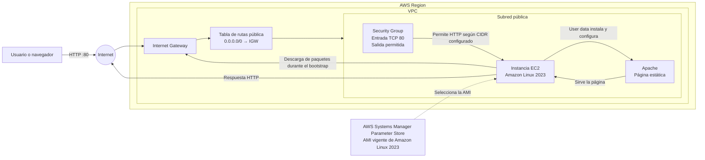
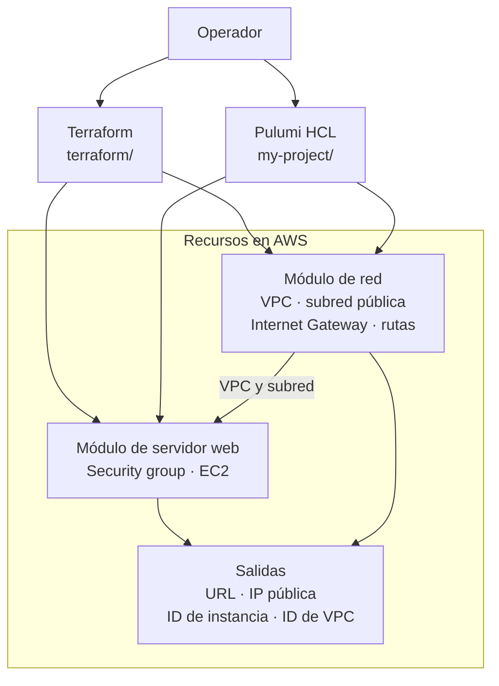

# AWS IaC Web Server

Proyecto de infraestructura como código que despliega una página web estática servida por Apache en una instancia Amazon EC2. La infraestructura está organizada en módulos de red y servidor web y cuenta con dos implementaciones: Terraform y Pulumi con runtime HCL.

## Arquitectura

La instancia se ubica en una subred pública. El tráfico HTTP entrante pasa por el Internet Gateway y el security group; la ruta predeterminada de la subred permite que la instancia descargue paquetes durante su inicialización. No se habilita SSH.



El siguiente diagrama muestra cómo las configuraciones raíz conectan los módulos reutilizables y exponen los resultados del despliegue:



### Componentes

- **VPC y subred pública:** la VPC habilita DNS. La subred asigna una IPv4 pública y tiene una ruta predeterminada hacia un Internet Gateway.
- **Security group:** permite TCP/80 desde el rango configurado y permite tráfico saliente. No define reglas de entrada para SSH.
- **EC2:** obtiene la AMI vigente de Amazon Linux 2023 desde Parameter Store. El script de inicialización instala y habilita Apache, y escribe la página de ejemplo.
- **Controles de instancia:** el token IMDSv2 es obligatorio y el volumen raíz gp3 de 8 GiB está cifrado.
- **Etiquetas y salidas:** los recursos reciben etiquetas del proyecto, entorno, despliegue y propietario. La configuración entrega la URL HTTP, IP pública, ID de instancia e ID de VPC.

## Implementaciones

| Implementación | Directorio | Detalles |
|---|---|---|
| Terraform | `terraform/` | Terraform `>= 1.10.0, < 2.0.0`; proveedor AWS `~> 6.0`; región predeterminada `us-east-1`; VPC `10.20.0.0/16` y subred `10.20.1.0/24`. |
| Pulumi (HCL) | `my-project/` | Runtime HCL y proveedor AWS; región definida en la configuración del stack; VPC `10.30.0.0/16` y subred `10.30.1.0/24`. |

Cada implementación crea su propia infraestructura y administra su propio estado. Elige una para cada despliegue y evita administrar los mismos recursos con ambas.

## Despliegue con Terraform

Se puede ejecutar Terraform localmente o conectar el repositorio a un workspace de HCP Terraform. Para HCP Terraform, configura `terraform` como directorio de trabajo y habilita autenticación AWS segura, preferiblemente credenciales dinámicas.

Requisitos: Terraform compatible con la versión declarada y credenciales AWS con permisos para crear los recursos descritos.

```powershell
cd terraform
terraform init
terraform validate
terraform plan -var="deployment_id=felipe-lab-01"
terraform apply -var="deployment_id=felipe-lab-01"
```

`deployment_id` es obligatorio: debe tener entre 3 y 20 caracteres en minúsculas, dígitos o guiones. En HCP Terraform, configúralo como variable del workspace en lugar de pasarlo en la línea de comandos. Usa un workspace y un estado distintos para cada despliegue independiente.

Las variables principales de Terraform son:

| Variable | Predeterminado | Descripción |
|---|---|---|
| `aws_region` | `us-east-1` | Región AWS. |
| `deployment_id` | Obligatoria | Identificador único del despliegue. |
| `owner_name` | `Felipe Velasco Sanchez` | Nombre que aparece en la página. |
| `environment` | `iacChallenge` | Etiqueta de entorno. |
| `http_ingress_cidr` | `0.0.0.0/0` | Rango IPv4 autorizado para HTTP. Restringe este valor cuando la página no deba ser pública. |
| `instance_type` | `t2.micro` | Tipo de instancia EC2. |

Al finalizar, elimina los recursos creados:

```powershell
terraform destroy -var="deployment_id=felipe-lab-01"
```

## Despliegue con Pulumi

El proyecto Pulumi usa HCL y se encuentra en `my-project/`. Selecciona o crea un stack, configura la región y el propietario, y despliega desde ese directorio:

```powershell
cd my-project
pulumi stack select felipe-pulumi-01
pulumi config set aws:region us-east-1
pulumi config set aws-iac-web-server-pulumi:owner_name "Felipe Velasco Sanchez"
pulumi up
```

Si el stack aún no existe, créalo primero con `pulumi stack init felipe-pulumi-01` en lugar de `pulumi stack select`.

Configura las credenciales de AWS de acuerdo con tu entorno antes de desplegar. La configuración del stack incluida en el proyecto especifica el perfil AWS `internship-dev`; cámbialo o utiliza el mecanismo de credenciales de tu entorno si ese perfil no está disponible.

Para eliminar los recursos del stack:

```powershell
pulumi destroy
```

## Seguridad y costos

- El valor predeterminado de Terraform (`http_ingress_cidr = "0.0.0.0/0"`) y el de Pulumi (`allowed_http_cidrs = ["0.0.0.0/0"]`) permiten acceso HTTP desde cualquier IPv4. Limítalo a los rangos necesarios si no se trata de una demostración pública.
- No se abre SSH. La administración remota de la instancia no forma parte de esta arquitectura.
- No guardes claves de AWS ni archivos de estado en el repositorio. Revisa el plan de Terraform o el preview de Pulumi antes de aplicar cambios.
- EC2, IPv4 pública y transferencia de datos pueden generar cargos. Destruye el despliegue cuando ya no lo necesites.
